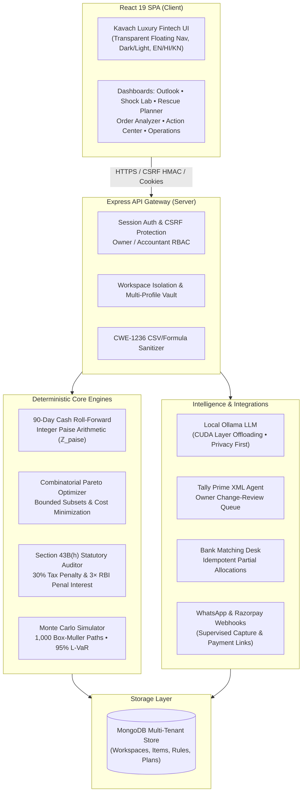

# Kavach Fin-Copilot (CashFlow Copilot)

[](https://nodejs.org/)
[](https://react.dev/)
[](https://www.mongodb.com/)
[](https://vitejs.dev/)
[](https://ollama.com/)
[](https://vitest.dev/)
[](LICENSE)

> **Autonomous 90-Day Liquidity Defense, Combinatorial Rescue Optimizer & Statutory Section 43B(h) Risk Radar for Indian MSMEs & Tier-2/3 Suppliers.**

---

## Table of Contents

- [Overview & The Problem](#overview--the-problem)
- [System Architecture](#system-architecture)
- [Core Capabilities](#core-capabilities)
  - [1. Deterministic 90-Day Cash Roll-Forward](#1-deterministic-90-day-cash-roll-forward)
  - [2. Combinatorial Pareto Rescue Optimizer](#2-combinatorial-pareto-rescue-optimizer)
  - [3. Section 43B(h) Statutory Risk Radar](#3-section-43bh-statutory-risk-radar)
  - [4. Stochastic Monte Carlo Risk Simulator](#4-stochastic-monte-carlo-risk-simulator)
  - [5. New Order Analyzer & Capital Health Gauge](#5-new-order-analyzer--capital-health-gauge)
  - [6. Privacy-Preserving Fin-RAG & Telegram Copilot](#6-privacy-preserving-fin-rag--telegram-copilot)
  - [7. Bidirectional Tally Prime XML & Bank Reconciliation](#7-bidirectional-tally-prime-xml--bank-reconciliation)
  - [8. Supervised WhatsApp Automation & Instant Payment Links](#8-supervised-whatsapp-automation--instant-payment-links)
  - [9. Enterprise Security & Multi-Tenant Isolation](#9-enterprise-security--multi-tenant-isolation)
  - [10. Luxury Kavach Design System & Localization](#10-luxury-kavach-design-system--localization)
- [Technology Stack](#technology-stack)
- [Getting Started](#getting-started)
  - [Prerequisites](#prerequisites)
  - [Local Development Setup](#local-development-setup)
  - [One-Click Isolated Demo](#one-click-isolated-demo)
  - [Docker Containerized Run](#docker-containerized-run)
- [Guided Demo Scenario](#guided-demo-scenario)
- [Local LLM Configuration (Ollama / CUDA GPU Offload)](#local-llm-configuration-ollama--cuda-gpu-offload)
- [API Reference](#api-reference)
- [Verification & Quality Assurance](#verification--quality-assurance)
- [Directory Structure](#directory-structure)

---

## Overview & The Problem

India's **6.3 Crore MSMEs** generate **30%+ of national GDP**, **45% of manufacturing output**, and **40% of exports**. Despite operational profitability, they face severe structural liquidity challenges:

- **Working Capital Asymmetry:** Suppliers must pay raw material vendors and worker payroll within 7–15 days, while enterprise buyers and OEMs enforce 60- to 120-day credit terms. Over **₹12.8 Lakh Crore** remains locked in delayed B2B receivables across India.
- **Section 43B(h) Compliance Deadline:** Effective AY 2024–25, invoice delays beyond 45 days (with written contract) or 15 days (without contract) trigger **100% corporate tax disallowance** for the buyer, plus compound penal interest at **3× the RBI bank rate** under the MSMED Act.
- **The Blindspot:** Standard accounting packages (Tally, Zoho Books) record past accounting history. They do not simulate future cash crises, quantify order risk before acceptance, or generate mathematical rescue paths.

**Kavach Fin-Copilot** bridges this gap: an autonomous liquidity command center that forecasts cash deficits up to 90 days in advance, optimizes shortfall rescue plans using Pareto tradeoffs, tracks Section 43B(h) compliance, and automates collection workflows.

---

## System Architecture



---

## Core Capabilities

### 1. Deterministic 90-Day Cash Roll-Forward
- **Integer Paise Representation ($\mathbb{Z}_{\text{paise}}$):** Money is strictly computed as integer paise to eliminate IEEE-754 floating-point rounding drift.
- **Reserve-Aware Headroom:** Configurable emergency reserve buffer. Headroom calculations indicate actual spendable liquidity rather than raw bank balances.
- **Auditable Daily Movements:** Transparent breakdown of daily inflows, outflows, verified invoice dates, and owner-assumed dates.

### 2. Combinatorial Pareto Rescue Optimizer
- **Deficit Resolution:** When projected cash breaches zero or the reserve threshold, the engine evaluates available levers (customer discount incentives, supplier payment rescheduling, working capital lines).
- **2D Pareto Frontier:** Visualizes cost vs. cash recovery tradeoff curves, empowering owners to select the most cost-effective path.
- **Hypothetical Plan Isolation:** Viewing, testing, or saving a rescue plan leaves actual ledger cash records completely untouched.

### 3. Section 43B(h) Statutory Risk Radar
- **Automated Clause Compliance:** Real-time calculation of 15-day (unwritten) and 45-day (written agreement) statutory payment horizons under the MSMED Act.
- **Penalty Computation:** Automatically calculates the buyer's 30% corporate income tax penalty and compound monthly penal interest (3× RBI repo rate).
- **Formal Notice Generation:** Produces downloadable, audit-ready demand notices ready to share with enterprise finance teams.

### 4. Stochastic Monte Carlo Risk Simulator
- **Delay Stress Testing:** Delay key customer receivables by 7, 15, or 30 days to observe impact on daily liquidity.
- **1,000 Simulated Paths:** Uses Box-Muller Gaussian transformation to model collection uncertainty and calculate the **95% Liquidity Value-at-Risk (L-VaR)**.
- **Rescue Robustness Testing:** Stress-tests active rescue plans against simulated customer default paths to verify whether the plan survives delayed collections.

### 5. New Order Analyzer & Capital Health Gauge
- **Opportunity Evaluation:** Evaluates prospective purchase orders against current workspace liquidity before making production or raw material commitments.
- **Minimum Advance Calculator:** Calculates the exact advance payment percentage required from the buyer to prevent entering a cash deficit during production.
- **Material Scheduling:** Schedules phased supplier material purchases against the delivery timeline.

### 6. Privacy-Preserving Fin-RAG & Telegram Copilot
- **Local Ollama & Cloud RAG:** Runs on-premise using open models (e.g., Huihui-GLM-4, Llama 3) via Ollama with dedicated GPU VRAM offloading, or connects to Google Gemini Generative RAG for natural language ledger queries.
- **2-Way Telegram Assistant:** Autonomous background Telegram bot (`server/src/services/ai/telegramCopilot.js`) with long-polling that queries live MongoDB financial records and replies directly to authenticated business owners on mobile.
- **Strict Data Containment:** Only the active workspace ledger, recurring rules, and computed forecast are passed to the model context.
- **Guaranteed Fallback:** If LLM endpoints timeout or are offline, the copilot falls back to an exact, rule-based deterministic response drawer.

### 7. Bidirectional Tally Prime XML & Bank Reconciliation
- **Tally XML Integration:** Windows PowerShell sync agent connects to Tally Prime; changed, deleted, or backdated vouchers are routed to an owner review queue.
- **Bank Statement Matching:** Reconciles uploaded bank statement credits to customer invoices and debits to supplier bills with partial settlement and duplicate protection.

### 8. Supervised WhatsApp Automation & Instant Payment Links
- **Inbound Capture via n8n:** Receives WhatsApp messages (`ORDER|...` and `PROMISE|...`) and stages them as reviewable drafts without automatic execution.
- **Razorpay Instant Settlement:** Generates test payment links sent via WhatsApp. When settled, signed webhook callbacks idempotently apply the receipt to the invoice.

### 9. Enterprise Security & Multi-Tenant Isolation
- **Role-Based Access Control (RBAC):** Distinct permissions for business owners and accountants.
- **Hardened Sessions:** Salted password hashing, opaque session cookies, and HMAC-validated CSRF tokens.
- **Data Protection:** CWE-1236 spreadsheet injection sanitation, append-only change logs, and one-time emergency recovery codes.

### 10. Luxury Kavach Design System & Localization
- **Modern Interface:** High-contrast luxury fintech aesthetic with transparent floating glass navigation and dark/light mode toggles.
- **Native Localization:** Complete browser-persisted translations for **English**, **Hindi (हिंदी)**, and **Kannada (ಕನ್ನಡ)**.

---

## Technology Stack

| Layer | Technologies |
| :--- | :--- |
| **Frontend** | React 19, Vite 7.3, Recharts, Modern CSS Glassmorphism |
| **Backend** | Node.js 22 LTS, Express 4.21, Mongoose 8.19, Zod |
| **Database** | MongoDB 7.0 (Atlas / Local Server / Embedded in-memory for testing) |
| **Local AI** | Ollama Engine (CUDA v12 optimization), Optional OpenAI / Gemini connectors |
| **Automations** | n8n Workflows, Meta WhatsApp Cloud Webhooks, Razorpay SDK |
| **Testing** | Vitest 4, Supertest, React Testing Library, jsdom |

---

## Getting Started

### Prerequisites

- **Node.js**: `v20.x` or `v22.x` (LTS recommended)
- **npm**: `v10.x` or higher
- **MongoDB**: Local MongoDB instance (`mongodb://localhost:27017/cashflow-copilot`) or a MongoDB Atlas connection string.

---

### Local Development Setup

1. **Clone the repository:**
   ```bash
   git clone https://github.com/your-username/cashflow-copilot.git
   cd cashflow-copilot
   ```

2. **Configure environment variables:**
   ```bash
   cp server/.env.example server/.env
   ```
   Open `server/.env` and configure your settings:
   ```env
   PORT=5000
   MONGODB_URI=mongodb://localhost:27017/cashflow-copilot
   SESSION_SECRET=choose-a-strong-secret-key-at-least-32-chars
   CLIENT_ORIGIN=http://localhost:5173
   ```

3. **Install dependencies:**
   ```bash
   npm --prefix server install
   npm --prefix client install
   ```

4. **Verify database & seed real-world MSME data (optional):**
   ```bash
   npm run db:check
   npm run seed:realworld    # Seeds realistic multi-buyer/supplier records
   ```

5. **Start development servers:**
   - In terminal 1 (Express API):
     ```bash
     npm run dev
     ```
   - In terminal 2 (Vite React Client):
     ```bash
     npm --prefix client run dev
     ```
   - Open your browser at `http://localhost:5173`.

---

### One-Click Isolated Demo

Run a self-contained demonstration using an isolated in-memory database that automatically seeds realistic fixture data and cleans up on exit:

```bash
npm run demo
```

1. Open `http://localhost:5000`.
2. Register an account (passwords require $\ge 15$ characters).
3. Select **Use seeded demo workspace** to load the complete manufacturing supplier scenario.

---

### Docker Containerized Run

Run the entire stack in isolated containers:

```bash
docker compose up --build
```
Access the application at `http://localhost:5001`.

---

## Guided Demo Scenario

To reproduce the benchmark manufacturing supplier shortfall scenario:

1. **Create an account** at `http://localhost:5173`.
2. Go to **Setup & Import** and select **Use seeded demo workspace** (or create a workspace dated `2026-11-01` with `₹2,00,000` opening cash and zero reserve, then import `fixtures/receivables.csv` and `fixtures/payables.csv`).
3. Open **Cash Outlook**:
   - Notice the projected deficit turning negative on **2026-11-06** and reaching a shortfall of **-₹2,00,000** on **2026-11-11**.
4. Open **Rescue Planner**:
   - Click **Find rescue options**.
   - Review the candidate action packages on the Pareto frontier.
   - Inspect how an early collection card resolves the cash gap with minimal discount cost.
5. Open **New Order Analyzer**:
   - Model an incoming **₹8,00,000** order requiring **₹5,00,000** in upfront material costs.
   - The engine calculates the safe minimum customer advance percentage needed to preserve liquidity.
6. Open **Section 43B(h) Auditor**:
   - Review delayed receivables subject to statutory disallowance penalties and generate audit-ready notices.

---

## Local LLM Configuration (Ollama / CUDA GPU Offload)

Fin-Copilot provides private, air-gapped ledger intelligence through Ollama without sending financial records to external cloud APIs:

```env
# server/.env
OLLAMA_BASE_URL=http://127.0.0.1:11434
OLLAMA_MODEL=alibilge/Huihui-GLM-4.6V-Flash-abliterated:q4_k_s
```

### Dedicated GPU Acceleration (NVIDIA RTX 4050 / 3060)
For dedicated local GPU environments, configure the background helper:
```env
OLLAMA_PORT=11435
OLLAMA_LLM_LIBRARY=cuda_v12
OLLAMA_NUM_GPU=26
OLLAMA_NUM_CTX=4096
```
This offloads 26 transformer layers into VRAM while keeping usage comfortably below 6 GB to prevent CUDA initialization timeouts.

---

## API Reference

All monetary amounts in the API are represented as **integer paise** (`₹1.00 = 100 paise`).

### Core Workspaces & Ledger
| Method | Endpoint | Description |
| :--- | :--- | :--- |
| `GET` | `/api/health` | Service health status check |
| `POST` | `/api/workspaces` | Create an isolated business workspace |
| `GET` | `/api/workspaces/:id` | Fetch workspace profile and cash configuration |
| `POST` | `/api/workspaces/:id/imports/inspect` | Inspect CSV/XLSX imports (CWE-1236 sanitized) |
| `POST` | `/api/workspaces/:id/imports/:batchId/commit` | Idempotent commit of inspected records |
| `GET` | `/api/workspaces/:id/forecast` | Compute 90-day cash forecast (`?horizonDays=90`) |

### Stress & Optimization
| Method | Endpoint | Description |
| :--- | :--- | :--- |
| `POST` | `/api/workspaces/:id/shock/analyze` | Simulate 7/15/30-day customer delay scenarios |
| `POST` | `/api/workspaces/:id/shock/explain` | Structured explanation of deficit drivers |
| `POST` | `/api/workspaces/:id/rescue/analyze` | Compute combinatorial Pareto rescue actions |
| `GET/POST`| `/api/workspaces/:id/rescue/plans` | Save and inspect hypothetical rescue plans |
| `POST` | `/api/workspaces/:id/orders/analyze` | Compute minimum advance for prospective orders |

### Operations & Automations
| Method | Endpoint | Description |
| :--- | :--- | :--- |
| `POST` | `/api/workspaces/:id/sync/runs` | Submit Tally sync voucher payload |
| `GET` | `/api/workspaces/:id/sync/changes` | Review queue for changed or backdated records |
| `POST` | `/api/workspaces/:id/bank/:txId/match-debit` | Reconcile bank debit with partial allocations |
| `POST` | `/api/capture-automation/messages` | Ingest WhatsApp order/promise drafts (Bearer auth) |
| `POST` | `/api/webhooks/razorpay` | Signed webhook for instant payment confirmations |

---

## Verification & Quality Assurance

The test suite runs in-memory MongoDB instances across 44 test files covering calculation invariants, multi-tenant isolation, and UI components:

```bash
# Run the complete test suite
npm test

# Run a focused test suite
npm --prefix server test -- tests/finance-api.test.js

# Verify client build
npm run build
```

Key verified invariants include:
- **Math Invariance:** Discrete integer math prevents fractional rupee drift across roll-forward projections.
- **Hypothetical Isolation:** Simulating or saving rescue plans and new order analyses does not alter underlying cash records.
- **Tenant Isolation:** Cross-business queries and unauthorized role actions are rejected at the service boundary.

---

## Directory Structure

```
cashflow-copilot/
├── client/                     # React 19 Frontend
│   ├── public/                 # Static assets and n8n workflow blueprints
│   └── src/
│       ├── app/                # Root App component and router
│       ├── components/         # Reusable widgets (Gauges, Tables, Inspector)
│       ├── i18n/               # Localization strings (EN, HI, KN)
│       ├── pages/              # Domain views (Outlook, Rescue, Shock Lab, etc.)
│       └── styles.css          # Kavach luxury design system
├── server/                     # Express API & Domain Services
│   ├── scripts/                # Database check, demo runner, and audit tools
│   ├── src/
│   │   ├── controllers/        # Route controllers
│   │   ├── middleware/         # Auth, CSRF, and tenant isolation guards
│   │   ├── models/             # Mongoose schemas
│   │   ├── routes/             # API route definitions
│   │   └── services/           # Finance engine, rescue optimizer, RAG indexer
│   └── tests/                  # Vitest suite (44 files, 240+ tests)
├── docs/                       # Specifications, research plans, and architecture docs
├── fixtures/                   # Standardized synthetic CSVs for deterministic evaluation
└── package.json                # Workspace scripts
```

---

## License

This project is licensed under the [MIT License](LICENSE).
