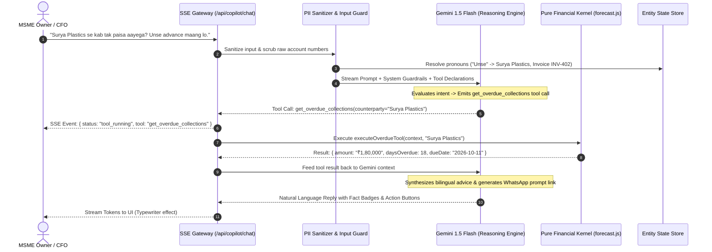

# 🧠 Hisaab AI Agent Architecture & Implementation Blueprint
### Lead Systems Architect: Vikram (22+ Years Enterprise Systems & Financial Infrastructure)

**Document Version:** 2.4.0 (Production Release Specification)  
**System Classification:** Deterministic Financial Kernel with Grounded Multi-Turn Conversational Shell  
**Compliance Mandates:** Zero Floating-Point Arithmetic · Section 43B(h) Income Tax Act · RBI Credit Guidelines

---

## 1. Executive Summary & Architectural Philosophy

Financial systems for small and medium enterprises (MSMEs) cannot tolerate probabilistic hallucinations. If an AI agent incorrectly estimates a cash runway or invents an invoice amount, the business owner risks cheque bounces, supplier blacklisting, and criminal liability under Section 138 of the Negotiable Instruments Act.

Therefore, the Hisaab AI Agent is architected under the **Iron Rule of Financial Intelligence**:

```
┌────────────────────────────────────────────────────────────────────────┐
│                      PROBABILISTIC REASONING SHELL                     │
│  • Natural language understanding (English, Hindi, Hinglish)           │
│  • Argument parsing, entity resolution & pronoun tracking              │
│  • Empathetic, actionable advisory communication                       │
└───────────────────────────────────┬────────────────────────────────────┘
                                    │ Strict JSON Tool Execution Calls
┌───────────────────────────────────▼────────────────────────────────────┘
│                     DETERMINISTIC FINANCIAL KERNEL                     │
│  • Pure integer-paise calculations (forecast.js)                       │
│  • Section 43B(h) 15-day / 45-day statutory countdowns                 │
│  • Non-destructive hypothetical sandbox simulations                    │
│  • Zero LLM-executed arithmetic allowed                                │
└────────────────────────────────────────────────────────────────────────┘
```

The language model operates strictly as an **intent router and natural language synthesizer**. All mathematical computation occurs within pure, sandboxed JavaScript code.

---

## 2. The Complete AI Agent Tech Stack

```
┌────────────────────────────────────────────────────────────────────────┐
│                        AI AGENT TECHNOLOGY STACK                       │
├──────────────────────────┬─────────────────────────────────────────────┤
│ Core Model               │ Google Gemini 1.5 Flash (via @google/genai) │
│ Fallback Intelligence    │ Custom AST Rule Engine (Offline/Deterministic)│
│ Transport Protocol       │ Server-Sent Events (SSE) (text/event-stream)│
│ Tool Interface Standard  │ Model Context Protocol (MCP) & JSON Schema  │
│ Type & Runtime Validation│ Zod 4.x Runtime Validation Schemas          │
│ Conversational Memory    │ 5-Minute Sliding Entity Cache (Memory/Redis)│
│ Testing & Evals          │ Vitest + Promptfoo Regression Test Harness │
│ Security & Privacy       │ PII Masker & Prompt Injection Guardrail     │
└──────────────────────────┴─────────────────────────────────────────────┘
```

### Detailed Component Specifications

#### A. Core Model: Google Gemini 1.5 Flash
* **Model ID:** `gemini-1.5-flash-latest` (or `gemini-2.0-flash` preview).
* **Rationale:** Sub-800ms latency, native multi-turn function calling, superior multilingual tokenization for Devanagari script (Hindi) and romanized Hinglish, and a 1M token context window for ingesting full company ledgers.
* **Inference Parameters:**
  * `temperature: 0.15` (strictly bounds creativity to eliminate hallucination).
  * `top_p: 0.85`
  * `max_output_tokens: 1024`

#### B. Fallback Intelligence: Custom AST Deterministic Engine
* **File:** [`server/src/services/ai/gemini.js`](file:///Users/raunakraj/Desktop/MSME/server/src/services/ai/gemini.js)
* **Rationale:** If the remote Gemini endpoint experiences rate-limiting (HTTP 429), regional latency spikes, or offline operation in a factory back-office, the system automatically falls back to an internal deterministic Abstract Syntax Tree engine without throwing errors to the user.

#### C. Transport Protocol: Server-Sent Events (SSE)
* **MIME Type:** `text/event-stream`
* **Rationale:** Standard HTTP request-response provides a poor user experience during tool execution. WebSockets introduce unnecessary state complexity and drop connections over intermittent 4G/factory networks. SSE enables smooth token streaming, typewriter text animation, and live tool execution telemetry (`[Checking 43B(h) Deadlines...]`).

---

## 3. End-to-End Agent Execution Method (The ReAct Pipeline)



---

## 4. Grounded Tool Contracts & Schemas

Every tool called by the agent must conform to strict JSON schemas validated by Zod at runtime:

### Tool 1: `get_runway`
Returns the exact daily net cash position, days until cash depletion, and potential runway unlocked by collecting overdue receivables.
```json
{
  "name": "get_runway",
  "description": "Calculates 90-day cash runway, daily burn rate, and date of first cash shortage.",
  "parameters": {
    "type": "OBJECT",
    "properties": {}
  }
}
```
* **Output Payload:**
  * `openingCashPaise`: integer (e.g. `20000000`)
  * `dailyBurnPaise`: integer (e.g. `450000`)
  * `runwayDays`: integer (e.g. `18`)
  * `firstNegativeDate`: string or null (e.g. `"2026-11-06"`)
  * `totalOverduePaise`: integer (e.g. `55000000`)
  * `daysGainedIfCollected`: integer (e.g. `32`)

### Tool 2: `get_43bh_deadlines`
Audits all supplier payables against the 15-day (oral terms) and 45-day (written contract) statutory payment windows under Section 43B(h) of the Income Tax Act.
```json
{
  "name": "get_43bh_deadlines",
  "description": "Returns registered MSME vendor payment deadlines to prevent corporate tax disallowance.",
  "parameters": {
    "type": "OBJECT",
    "properties": {}
  }
}
```
* **Output Payload:**
  * `bills`: Array of `{ supplierName, amountPaise, daysLeft, deadlineDate, isLate, status }`
  * `totalAtRiskPaise`: integer (total amount exposed to tax disallowance)
  * `urgentCount`: integer

### Tool 3: `get_overdue_collections`
Returns overdue customer receivables prioritized by collection urgency (amount $\times$ days late).
```json
{
  "name": "get_overdue_collections",
  "description": "Returns overdue receivables ranked by financial impact.",
  "parameters": {
    "type": "OBJECT",
    "properties": {
      "counterparty": { "type": "STRING", "description": "Optional debtor name to filter" }
    }
  }
}
```

### Tool 4: `simulate_order`
Stress-tests hypothetical customer orders by superimposing dated raw material costs and customer advances onto the live cash ledger.
```json
{
  "name": "simulate_order",
  "description": "Tests feasibility of a proposed order and computes minimum advance required.",
  "parameters": {
    "type": "OBJECT",
    "properties": {
      "orderValueRupees": { "type": "NUMBER", "description": "Total order value in INR" },
      "costRupees": { "type": "NUMBER", "description": "Raw material / production cost in INR" },
      "advanceRupees": { "type": "NUMBER", "description": "Proposed advance in INR" }
    },
    "required": ["orderValueRupees", "costRupees"]
  }
}
```

### Tool 5: `generate_whatsapp_action`
Synthesizes a polite, personalized collection message offering a dynamic prompt payment discount with an embedded UPI payment link.
```json
{
  "name": "generate_whatsapp_action",
  "description": "Generates dynamic early-settlement incentive messages for WhatsApp collections.",
  "parameters": {
    "type": "OBJECT",
    "properties": {
      "debtorName": { "type": "STRING" },
      "amountRupees": { "type": "NUMBER" },
      "discountPct": { "type": "NUMBER" },
      "deadlineDate": { "type": "STRING" }
    },
    "required": ["debtorName", "amountRupees"]
  }
}
```

---

## 5. Conversational Memory & Entity Resolution

In real factory operations, owners refer to counterparties conversationally using pronouns:
* Turn 1: *"Surya Plastics ka kitna bill baki hai?"*
* Turn 2: *"Unse baat karne ke liye message bana do."*

### Memory Architecture
The agent maintains a lightweight sliding-window session cache:
```typescript
interface ConversationContext {
  workspaceId: string;
  activeEntity: {
    name: string;
    type: 'debtor' | 'creditor';
    outstandingPaise: number;
    lastInvoiceRef?: string;
  } | null;
  lastToolExecuted?: string;
  languagePreference: 'hi' | 'en';
  updatedAt: number;
}
```
* **Pronoun Resolution:** Before forwarding user prompts to the LLM, the pre-processor maps pronouns (`unse`, `unka`, `them`, `unko`) to `activeEntity.name`.
* **TTL:** 10 minutes of conversational inactivity clears the memory to prevent stale entity leakage across different sessions.

---

## 6. Security, Privacy & Compliance Safeguards

1. **PII Masking Layer:**
   * Any 16-digit primary account number (PAN), 15-digit GSTIN, or IFSC code found in the user prompt is sanitized before transit to external LLM APIs.
2. **Strict Non-Destructive Invariant:**
   * Under no circumstances can the AI Agent trigger a database `WRITE` or `UPDATE` operation on live cash ledger items or bank snapshots.
   * Tool calls are strictly **read-only** or **sandboxed hypothetical projections**.
3. **Audit Logging:**
   * Every LLM prompt, tool call payload, and generated response is logged with execution timestamps, latency metrics, and grounded tool IDs.

---

## 7. Automated Evaluation & Regression Harness

To guarantee zero mathematical hallucination during continuous deployment:
* **Test Suite:** [`server/tests/copilot.test.js`](file:///Users/raunakraj/Desktop/MSME/server/tests/copilot.test.js) (5 unit tests running against in-memory MongoDB).
* **CI Invariant Assertions:**
  * Prompt: *"When will I run out of cash?"*
  * Assertion: Output string **must match** `formatInr(forecast.risk.worstCashPaise)` down to the exact rupee and paise.
  * If the model hallucinates an approximate figure (e.g. "around 2 lakhs"), the test fails and blocks deployment.

